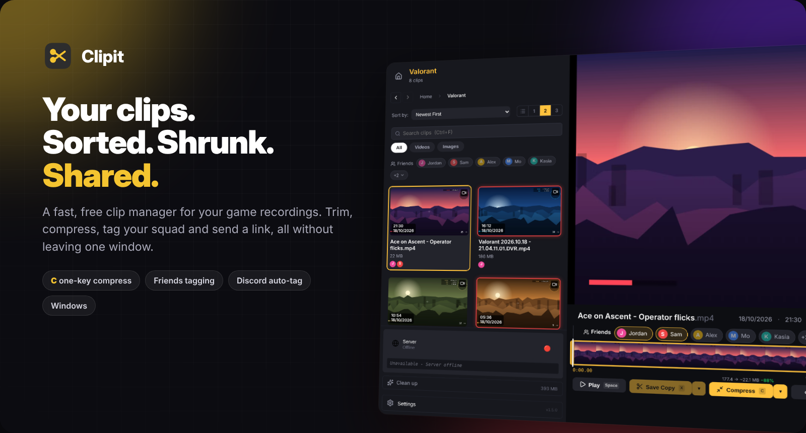
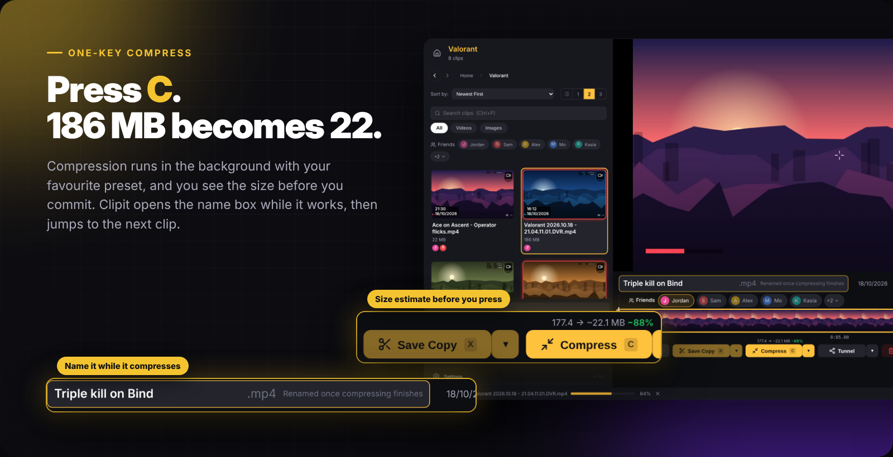
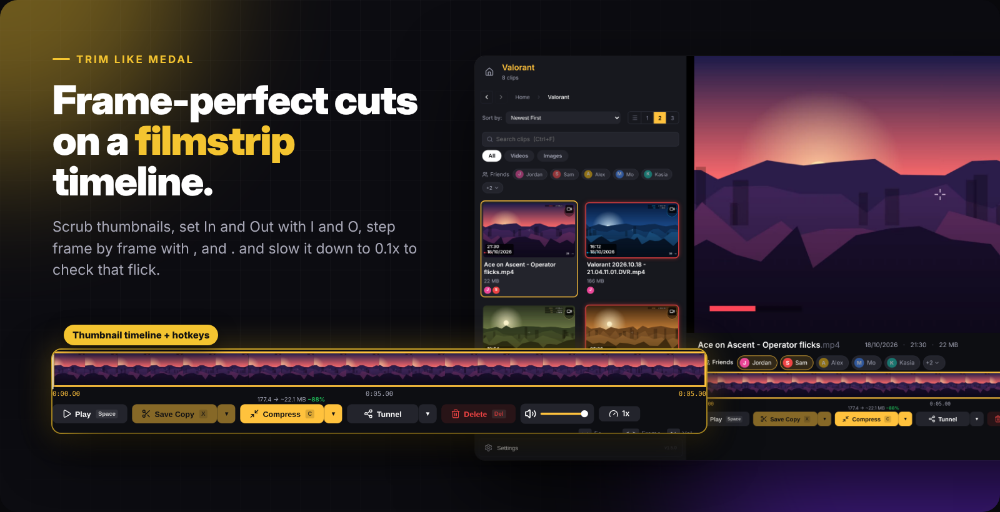
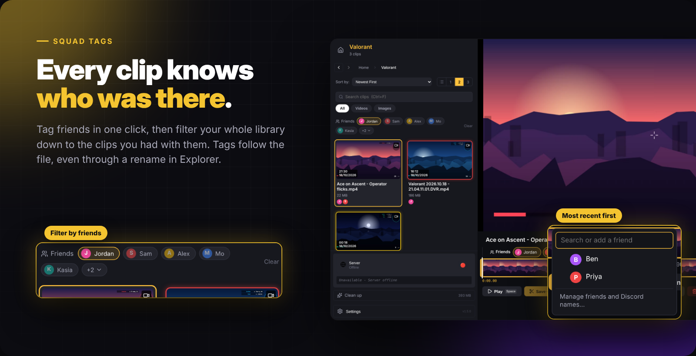
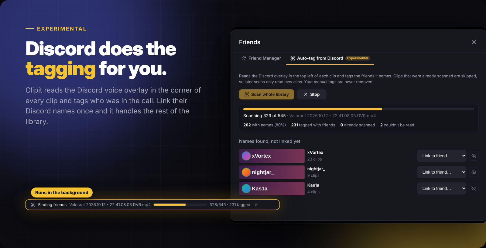
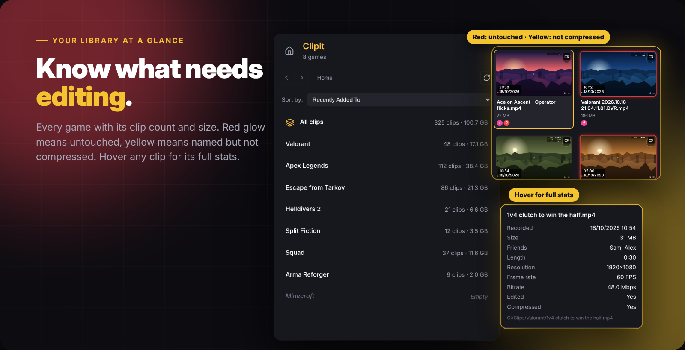

<p align="center">
  
</p>

<p align="center">
  <a href="https://github.com/compl3x-41/clipit/releases/latest"></a>
  
  
</p>

<h3 align="center">The clip manager for people with 500 ShadowPlay recordings and no time.</h3>

<p align="center">
  Clipit opens your recordings folder, sorts every clip by game and lets you trim, compress, name, tag and share them at the speed of a few key presses.<br/>
  No account, no cloud upload, no watermark. Your files stay exactly where they are.
</p>

<br/>



### Press C and move on

- **One key, one smaller clip.** <kbd>C</kbd> compresses with your last preset. <kbd>Shift</kbd>+<kbd>C</kbd> opens every option, including Discord-friendly presets, codec, resolution and FPS.
- **See the result before you commit.** The Compress button shows the estimated size, for example `177 MB → ~22 MB −88%`.
- **Never wait on a progress bar.** Jobs queue in the background with progress in the status bar, and you can keep watching other clips.
- **Name it while it shrinks.** On a raw ShadowPlay clip, <kbd>C</kbd> opens the name box straight away and jumps to the next clip when you press Enter. A clip that already has a name skips straight to the next one.
- **Trim and compress in one go.** Set In and Out, press <kbd>C</kbd>, and only that part is kept.

<br/>



### Trim like you would in Medal

- A **filmstrip timeline** with hover previews, so you can find the moment without scrubbing blind.
- <kbd>I</kbd> and <kbd>O</kbd> set the cut. <kbd>X</kbd> saves a trimmed copy, or overwrites the original if you prefer.
- <kbd>,</kbd> and <kbd>.</kbd> step one frame at a time, the arrow keys skip 3 seconds (or whatever you set), and one-click buttons switch between **0.25x, 0.5x, 1x and 2x**, with a menu from 0.1x to 5x.
- Trimmed and compressed files **keep the original recording date**, so nothing jumps around your list.

<br/>



### Remember who was there

- **Tag friends on any clip** in one click. The friends you've tagged most recently are always one click away.
- **Filter your library by friends.** Pick one or several and see every clip you had together, across every game.
- **Tags survive anything.** Rename or move a clip in Explorer and its friends stay with it, because they're stored on the file itself.
- **Your game folders stay untouched.** Clips stay in `Game → clips`, exactly as ShadowPlay saved them.

<br/>



### Let Discord do the tagging &nbsp;<sub>`EXPERIMENTAL` · next release</sub>

- Clipit reads the **Discord voice overlay** in the corner of each recording and tags everyone who was in the call.
- It uses the text recognition built into Windows, so there's **nothing extra to install**.
- **Friend Manager** links Discord names to your friends (`benjaminTTV` → Ben) and can merge duplicates. Names it doesn't know show up with a picture of where they were read, so linking takes one click.
- It scans your whole library in the background with **live progress and success rates**, and later scans only read new clips.
- A **developer test mode** runs on your 5 newest clips and shows exactly what the scan saw.

<br/>



### Your whole library at a glance

- **Every game folder** shows its clip count and size, sorted by the most recently added. Empty folders are shown too.
- **A glow tells you what's left to do:** red means untouched, yellow means named but not yet compressed. Clipit spots clips that are already compressed on its own.
- **Hover any clip** for its length, resolution, frame rate, bitrate, friends and edit status.
- Switch between a **list or 1, 2 or 3 clips across**, search with <kbd>Ctrl</kbd>+<kbd>F</kbd>, or open **All clips** to see every game at once.
- **New recordings appear on their own**, with no refresh button needed.

<br/>

## And everything else

| | |
|---|---|
| 🔗 **Share in seconds** | Send a temporary public link through a Cloudflare tunnel, or upload straight to Streamable. |
| ↩️ **Undo delete** | Deleted clips disappear with a 15 second Undo, and the next clip starts playing. |
| 🧹 **Clean up** | Thumbnails live in Clipit's own folder instead of your clips folder. One button clears the cache. |
| ⚡ **Hardware encoding** | NVIDIA NVENC, AMD AMF and Intel Quick Sync, picked automatically. |
| 🎨 **Two looks** | The Modern theme, inspired by Medal, or the original Classic theme. |
| 🔄 **Auto-updates** | New versions install themselves from GitHub releases. |

## Keyboard shortcuts

| Key | Action | Key | Action |
|---|---|---|---|
| <kbd>Space</kbd> | Play / pause | <kbd>C</kbd> | Compress (then name the clip) |
| <kbd>I</kbd> / <kbd>O</kbd> | Set In / Out | <kbd>Shift</kbd>+<kbd>C</kbd> | Compress options |
| <kbd>X</kbd> | Save trimmed copy | <kbd>R</kbd> | Reset trim |
| <kbd>←</kbd> / <kbd>→</kbd> | Skip (3s, adjustable) | <kbd>,</kbd> / <kbd>.</kbd> | Previous / next frame |
| <kbd>↑</kbd> / <kbd>↓</kbd> | Volume | <kbd>M</kbd> | Mute |
| <kbd>S</kbd> | Playback speed | <kbd>F</kbd> | Fullscreen |
| <kbd>Del</kbd> | Delete (with Undo) | <kbd>Ctrl</kbd>+<kbd>F</kbd> | Search clips |

## Install

**[Download the latest release](https://github.com/compl3x-41/clipit/releases/latest)** and run `Clipit-Setup-X.X.X.exe`. Point Clipit at your recordings folder (for example your ShadowPlay `Videos` folder) and you're done. Updates arrive on their own after that.

Linux builds (AppImage and .deb) can be built from source with `npm run build:linux`.

## Development

```bash
npm install
npm run download-ffmpeg
npm run download-cloudflared
npm run dev            # run with hot reload
npm run build:win      # build the Windows installer into release/
```

Built with Electron, React, TypeScript and FFmpeg.

### Releasing a new version

1. Bump `version` in `package.json` (and the two root entries in `package-lock.json`), and add the changes to `src/shared/changelog.ts`.
2. Push to `main`.

The **Release** workflow builds the Windows installer and publishes `v<version>` on GitHub when that release doesn't exist yet, and the in-app updater picks it up from there.

## Credits

Clipit started life as [lowbit/clipit](https://github.com/lowbit/clipit). This fork adds the Modern theme, compression, friends, Discord auto-tag and more on top of it.

## License

MIT
